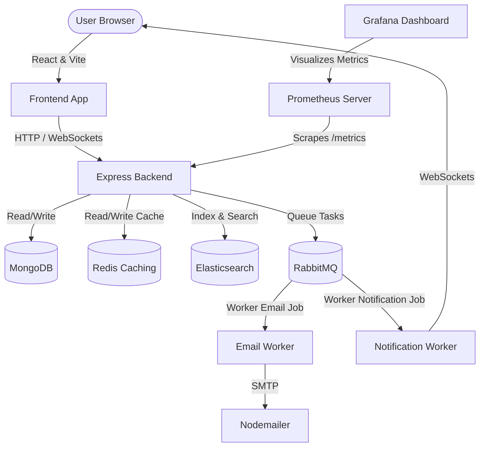

# 🍔 SmartEats

SmartEats is a premium, real-time food ordering and delivery web application built with a modern event-driven microservices architecture. Designed for performance, scalability, and seamless user experiences, it integrates live order tracking, advanced full-text search, high-performance caching, and production-grade system monitoring.

---

## 🚀 Key Features

* **Real-Time Live Tracking**: Real-time communication between customers and delivery partners using WebSockets.
* **Geofencing & Map Integration**: Interactive Leaflet maps for choosing delivery addresses and tracking orders visually.
* **Advanced Full-Text Search**: Instant, typo-tolerant search for food items and restaurants powered by Elasticsearch.
* **Reliable Asynchronous Tasks**: Decoupled mail delivery and notification workers using RabbitMQ queues.
* **Intelligent Caching**: High-performance API responses using Redis for rapid content loading.
* **Rich Dashboards & Analytics**: Sales statistics, order histories, and user management using interactive charts.
* **Comprehensive Monitoring**: Enterprise-grade metrics monitoring via Prometheus and Grafana dashboards.

---

## 🛠️ Technology Stack & Contributions

### Frontend (Client-Side)
* **React & Vite**: Fast, interactive single-page application framework with hot module replacement (HMR).
* **Redux Toolkit**: Centralized state management for authentication, cart, and location data.
* **TailwindCSS**: Modern, utility-first styling for a premium responsive interface.
* **Leaflet & React Leaflet**: Interactive map rendering for delivery location selection and tracking.
* **Socket.io Client**: Establishes WebSockets connections for real-time tracking updates.
* **Recharts**: Renders visual analytics and sales metrics on the owner dashboard.

### Backend (Server-Side)
* **Node.js & Express**: Extensible and lightweight server environment.
* **MongoDB & Mongoose**: Flexible, schema-based ODM storing user profiles, orders, shops, and food items.
* **Redis**: Used as a caching layer to store frequently accessed data, reducing database hits.
* **RabbitMQ**: Message broker managing asynchronous task queues (e.g., sending emails and notifications).
* **Elasticsearch**: Provides lightning-fast search capabilities for restaurants and food items.
* **Socket.io**: Powers duplex real-time socket connections for customers, shops, and delivery staff.
* **Nodemailer**: Handles delivery OTP notifications and password-reset emails.
* **Cloudinary**: Cloud asset storage for restaurant banners and food pictures.
* **Razorpay**: Digital payment gateway integration for secure checkouts.

---

## 📐 Architecture Diagram



---

## ⚙️ Getting Started

### Prerequisites
* [Node.js](https://nodejs.org/) (v16+ recommended)
* [Docker Desktop](https://www.docker.com/products/docker-desktop/) (for infrastructure containers)

---

### Step-by-Step Installation

#### 1. Clone & Setup Repository
```bash
git clone https://github.com/Bhargav-8055/Smart_Eats.git
cd Smart_Eats
```

#### 2. Start Services via Docker
Start Redis, RabbitMQ, Elasticsearch, Prometheus, and Grafana using the Docker configuration:
```bash
docker compose up -d
```
*Infrastructure configuration resides in [docker-compose.yml](file:///d:/SDC/SmartEats/SmartEats/docker-compose.yml).*

#### 3. Setup Environment Variables

Create a `.env` file inside the `backend` folder:
* **Backend config** ([backend/.env](file:///d:/SDC/SmartEats/SmartEats/backend/.env)):
  ```env
  PORT=8000
  MONGODB_URL="mongodb://localhost:27017/Vingo"
  JWT_SECRET="YOUR_JWT_SECRET"
  EMAIL="your-gmail@gmail.com"
  PASS="your-16-character-gmail-app-password"
  CLOUDINARY_CLOUD_NAME="your-cloudinary-name"
  CLOUDINARY_API_KEY="your-cloudinary-key"
  CLOUDINARY_API_SECRET="your-cloudinary-secret"
  RAZORPAY_KEY_ID="your-razorpay-key-id"
  RAZORPAY_KEY_SECRET="your-razorpay-secret"
  ```

Create a `.env` file inside the `frontend` folder:
* **Frontend config** ([frontend/.env](file:///d:/SDC/SmartEats/SmartEats/frontend/.env)):
  ```env
  VITE_FIREBASE_APIKEY="your-firebase-key"
  VITE_GEOAPIKEY="your-geo-api-key"
  VITE_RAZORPAY_KEY_ID="your-razorpay-test-key-id"
  ```

#### 4. Run Database Seeding (Optional)
To populate coupons for testing:
```bash
cd backend
node seed_coupons.js
```

#### 5. Run the Application

* **Start Backend Server**:
  ```bash
  cd backend
  npm run dev
  ```
  The server will spin up on `http://localhost:8000`.

* **Start Frontend Client**:
  ```bash
  cd frontend
  npm run dev
  ```
  The application will be served at `http://localhost:5173`.

---

## 📊 System Monitoring & Analytics

* **Prometheus**: Accessible at `http://localhost:9090` (Scrapes application performance metrics from `/metrics`).
* **Grafana**: Accessible at `http://localhost:3000` (Visualize Prometheus server metrics dynamically).

### index.html
#### <!DOCTYPE html>
#### <html lang="en">
#### <head>
####    <meta charset="UTF-8">
####    <meta name="viewport" content="width=device-width, initial-scale=1.0">
####    <title>Document</title>
#### </head>
#### <body>
    
#### </body>
#### </html>
